[Transformers Deep Dive](https://www.datacamp.com/tutorial/how-transformers-work?utm_cid=19589720824&utm_aid=157156376071&utm_campaign=230119_1-ps-other~dsa-tofu~all_2-b2c_3-apac_4-prc_5-na_6-na_7-le_8-pdsh-go_9-nb-e_10-na_11-na&utm_loc=9062011-&utm_mtd=-c&utm_kw=&utm_source=google&utm_medium=paid_search&utm_content=ps-other~apac-en~dsa~tofu~tutorial~machine-learning&gad_source=1&gad_campaignid=19589720824&gbraid=0AAAAADQ9WsEHPFlM7B-t4PxUymWCOvk3O&gclid=CjwKCAjwq8PVBhAKEiwA2i3SHV8yfflwk6_jUMhYJszRzbnmbTDkbIEUHnhKfXpu60VVzLImcti82xoCTuQQAvD_BwE)

# Basic Arch
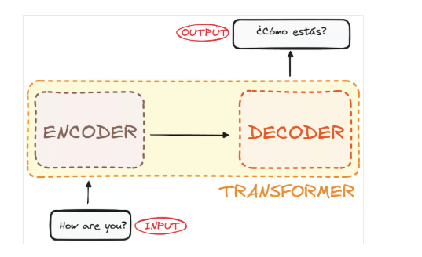

Both the encoder and the decoder are actually a stack with multiple layers (same number for each). 

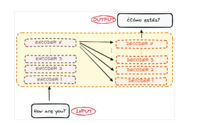

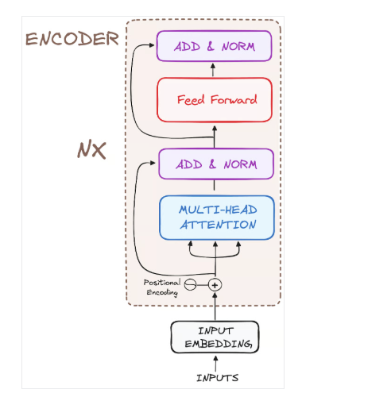

## STEP 1 - Input Embeddings

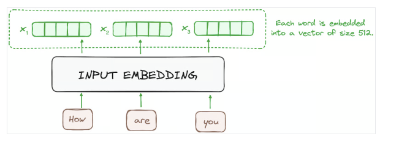

## STEP 2 - Positional Encoding
Uses positional encodings added to the input embeddings to provide information about the position of each token in the sequence. This allows them to understand the position of each word within the sentence.

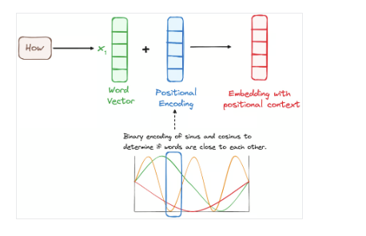

## STEP 3 - Stack of Encoder Layers

- A multi-headed attention mechanism.
- A fully connected network.

###  STEP 3.1 Multi-Headed Self-Attention Mechanism
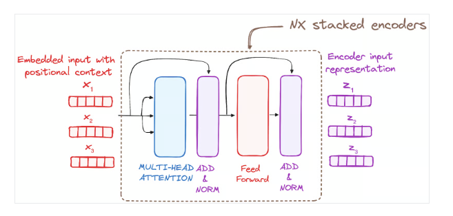

In the encoder, the multi-headed attention utilizes a specialized attention mechanism known as self-attention. This approach enables the models to relate each word in the input with other words. For instance, in a given example, the model might learn to connect the word “are” with “you”.

It computes attention scores based on:

- A query is a vector that represents a specific word or token from the input sequence in the attention mechanism.
- A key is also a vector in the attention mechanism, corresponding to each word or token in the input sequence.
- Each value is associated with a key and is used to construct the output of the attention layer. When a query and a key match well, which basically means that they have a high attention score, the corresponding value is emphasized in the output.

"The cat sat on the mat because it was tired."
Query: "it" (What word should I connect to?)
Each token produces a query vector. For example, the token “it” generates a representation that helps determine which surrounding words are relevant to it.

Key: "cat" 
Key: "mat"
Every token produces a key vector. The model compares the query against the keys of other tokens to calculate attention scores.

Value: information from "cat"

Every token produces a value vector. The model combines these value vectors according to the attention weights, giving more influence to relevant tokens.

This first Self-Attention module enables the model to capture contextual information from the entire sequence. Instead of performing a single attention function, queries, keys and values are linearly projected h times. On each of these projected versions of queries, keys and values the attention mechanism is performed in parallel, yielding h-dimensional output values.

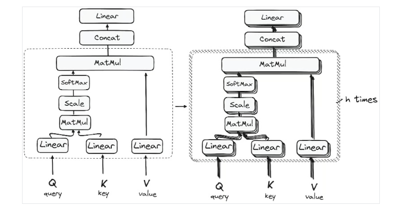

#### Reducing the Magnitude of attention scores
The scores are then scaled down by dividing them by the square root of the dimension of the query and key vectors

####  Applying Softmax to the Adjusted Scores
A softmax function is applied to the adjusted scores to obtain the attention weights. This results in probability values ranging from 0 to 1. The softmax function emphasizes higher scores while diminishing lower scores, thereby enhancing the model's ability to effectively determine which words should receive more attention.

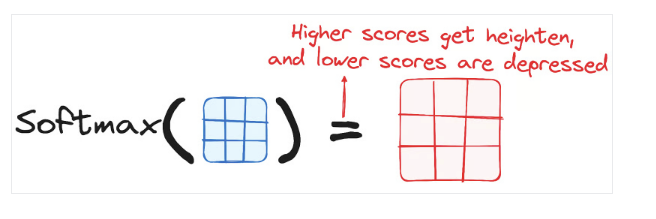

The following step of the attention mechanism is that weights derived from the softmax function are multiplied by the value vector, resulting in an output vector.

In this process, only the words that present high softmax scores are preserved. Finally, this output vector is fed into a linear layer for further processing.

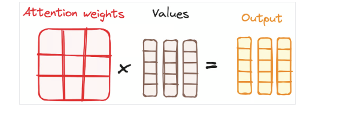

So, you might be wondering why it’s called Multi-Head Attention?

Remember that before all the process starts, we break our queries, keys and values h times. This process, known as self-attention, happens separately in each of these smaller stages or 'heads'. Each head works its magic independently, conjuring up an output vector.

### STEP 3.2 Normalization and Residual Connections
Each sub-layer in an encoder layer is followed by a normalization step. Also, each sub-layer output is added to its input (residual connection) to help mitigate the vanishing gradient problem, allowing deeper models. This process will be repeated after the Feed-Forward Neural Network too.

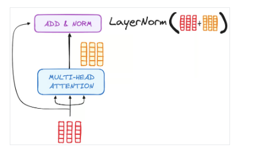

### STEP 3.3 Feed-Forward Neural Network

The journey of the normalized residual output continues as it navigates through a pointwise feed-forward network, a crucial phase for additional refinement.

Picture this network as a duo of linear layers, with a ReLU activation nestled in between them, acting as a bridge. Once processed, the output embarks on a familiar path: it loops back and merges with the input of the pointwise feed-forward network.

This reunion is followed by another round of normalization, ensuring everything is well-adjusted and in sync for the next steps.

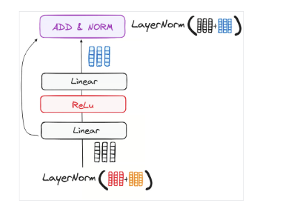

The Decoder Workflow
The decoder's role centers on crafting text sequences. Mirroring the encoder, the decoder is equipped with a similar set of sub-layers. It boasts two multi-headed attention layers, a pointwise feed-forward layer, and incorporates both residual connections and layer normalization after each sub-layer.

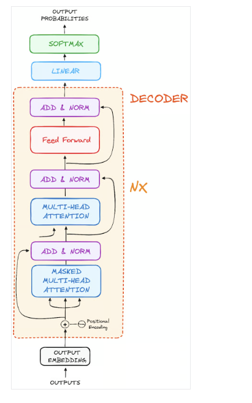
